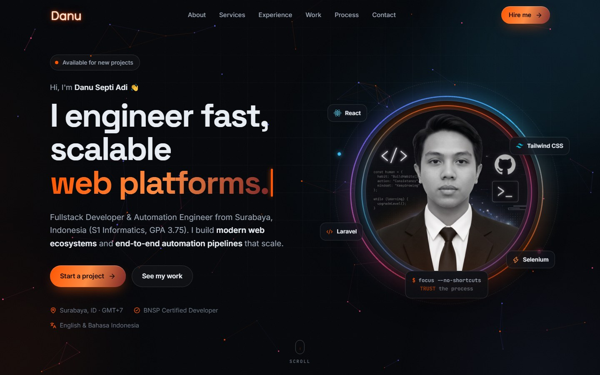
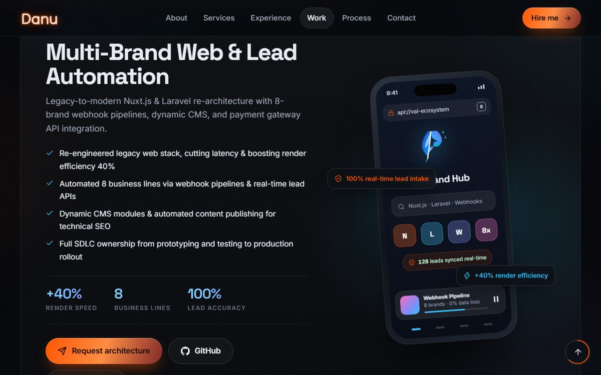
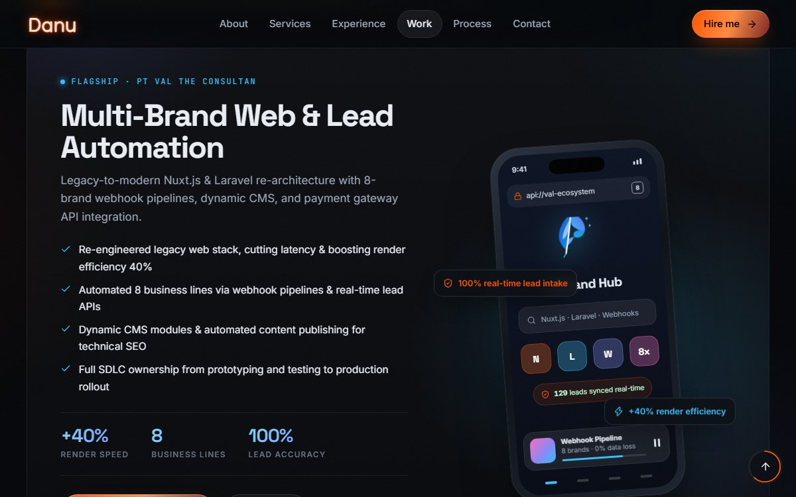
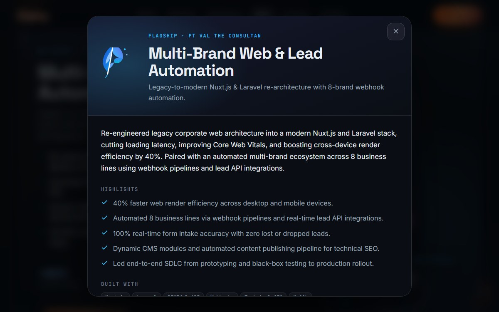

<div align="center">

# ⚡ Portfolio of Danu Septi Adi

### Fullstack Developer & Automation Engineer — Surabaya, Indonesia (GMT+7)

A fast, animated, single-file developer portfolio built in **one self-contained HTML file**.<br>
No frameworks · no build step · no dependencies · ready to deploy anywhere.

[**🌐 Portfolio Profile**](https://danu-septi-adi.github.io/profile) &nbsp;·&nbsp;
[**💻 GitHub**](https://github.com/danu-septi-adi) &nbsp;·&nbsp;
[**📄 CV (PDF)**](docs/biodata/CV_Danu_Septi_Adi_Fullstack_Automation.pdf) &nbsp;·&nbsp;
[**🎨 Customize**](docs/CUSTOMIZE.md) &nbsp;·&nbsp;
[**➕ Add a project**](docs/ADD-A-PROJECT.md)


[](LICENSE)



</div>

---

## 👋 About This Portfolio

This portfolio showcases my work as a **Fullstack Developer & Automation Engineer** (S1 Informatics Engineering, ITATS Surabaya — GPA 3.75/4.00, BNSP Certified Junior Web Developer).

Everything runs directly from [`index.html`](index.html) with zero build tools or external runtime dependencies:

- **Single-file architecture:** Styles, scripts, embedded fonts, SVG icons, and animations live in one place.
- **Consistent 3-tier orange neon theme:** `#ff5500` (Primary), `#ff8c42` (Secondary), and `#ffe4d4` (Highlight).
- **Works offline & deploys anywhere:** GitHub Pages, Netlify, Cloudflare Pages, Vercel, or any static host.

---

## ✨ Features

<table>
<tr><td width="50%" valign="top">

**🎬 Motion & Design**
- Fastboot-style **boot screen** (`deploy --stack fullstack-automation`, skippable)
- Interactive **particle network** behind the hero that reacts to the cursor
- Typing headline, word-by-word heading reveals, and scroll-triggered animations
- Portrait inside a glowing multi-ring frame with orbiting dots and floating tech chips
- 3-D tilt and cursor spotlight on cards, plus magnetic CTA buttons
- Neon **Danu** logo and footer sign with subtle flicker effects

</td><td width="50%" valign="top">

**🧩 Interactive Sections**
- Working **interactive terminal** (`help`, `whoami`, `skills`, `projects`, `open <name>`, `neofetch`, `cd <section>`, `github`, `portfolio`, `sudo hire-me`) with tab-completion & history
- **Featured case study** (*Multi-Brand Web & Lead Automation*) with an animated CSS phone mockup
- **Project grid** with category filters (`Fullstack`, `Automation`, `Security`, `Systems`) & keyboard-accessible case-study modals
- **Experience & Automation Matrix** with live metrics, system pipeline table, and credentials (*ITATS*, *BNSP*, *Arkatama*, *Dicoding*, *Skill Academy*)
- Hidden extras: Konami code & secret terminal commands

</td></tr>
<tr><td valign="top">

**📬 Working Contact Form**
- Direct inbox delivery to `danuseptiadi2291@gmail.com` via [FormSubmit](https://formsubmit.co) (no backend required)
- Client-side validation, honeypot spam trap, and confetti celebration on submit
- Automatic `mailto:` fallback if network submission fails
- One-click email copy and live `Surabaya, ID (GMT+7)` clock

</td><td valign="top">

**✅ Quality & Accessibility**
- Responsive from `320px` mobile screens to `4K` displays
- Respects `prefers-reduced-motion`
- Skip link, visible focus outlines, ARIA labels, and keyboard-navigable modals & mobile drawer
- SEO & link preview ready: Open Graph tags, JSON-LD `Person` schema, and inline SVG favicon

</td></tr>
</table>

---

## 📸 Tour

<table>
<tr>
<td width="50%"><br><sub><b>Featured project</b> — Multi-Brand Web & Lead Automation with CSS phone mockup</sub></td>
<td width="50%"><br><sub><b>Project grid</b> — animated icons, 3-D tilt, and category filters</sub></td>
</tr>
<tr>
<td><br><sub><b>Case-study popup</b> — detailed overview, highlights, and tech stack</sub></td>
<td><br><sub><b>Interactive terminal</b> — try <code>neofetch</code>, <code>whoami</code>, or <code>sudo hire-me</code></sub></td>
</tr>
<tr>
<td><br><sub><b>Experience & Automation Matrix</b> — live KPIs and pipeline table</sub></td>
<td><br><sub><b>Credentials & Certifications</b> — academic & industry verification</sub></td>
</tr>
</table>


---

## 🚀 Quick Start

### Option A: GitHub Pages
1. Push this repository to GitHub (e.g. `danu-septi-adi` or `danu-septi-adi.github.io`).
2. Go to **Settings → Pages**.
3. Under *Build and deployment*, choose **Deploy from a branch**, select **`main`** and **`/ (root)`**, then click **Save**.

### Option B: Any Static Host
Upload `index.html` (and `docs/biodata/` if linking the local photo/CV) to [Netlify Drop](https://app.netlify.com/drop), Cloudflare Pages, Vercel, or any web server.

### Option C: Run Locally
Open [`index.html`](index.html) directly in your browser, or run a quick local server:
```bash
python -m http.server 8080
```

---

## 🧩 Structure

```text
.
├── index.html                  # Complete self-contained portfolio (HTML + CSS + JS + fonts + SVG icons)
├── LICENSE                     # MIT License
├── README.md                   # Project documentation
└── docs/
    ├── ADD-A-PROJECT.md        # Guide to adding new project cards & animated icons
    ├── CUSTOMIZE.md            # Section-by-section customization guide
    ├── biodata/                # Resume (PDF/DOCX) and portrait photos
    ├── icon-templates/         # SVG icon templates
    └── screenshots/            # Up-to-date desktop & mobile screenshots
```

**Built with:** semantic HTML, modern CSS (custom properties, grid, `color-mix()`, `:has()`), vanilla JavaScript, Canvas 2D, inline SVG, and SMIL animations. **Zero external dependencies.**

---

## 🙏 Credits

- **Fonts:** [Inter](https://rsms.me/inter/), [Space Grotesk](https://fonts.google.com/specimen/Space+Grotesk), [JetBrains Mono](https://www.jetbrains.com/lp/mono/), [Tilt Neon](https://fonts.google.com/specimen/Tilt+Neon), and [Hind Siliguri](https://fonts.google.com/specimen/Hind+Siliguri) under [SIL OFL 1.1](https://openfontlicense.org).
- **Icons:** [Lucide](https://lucide.dev) (ISC) and [Simple Icons](https://simpleicons.org) (CC0).
- **Contact form:** [FormSubmit](https://formsubmit.co).

---

## 📄 License

Released under the [MIT License](LICENSE).

---

<div align="center">

Made with ♥ by **[Danu Septi Adi](https://github.com/danu-septi-adi)** — Fullstack Developer & Automation Engineer from Surabaya, Indonesia.<br>
Let's build something together → **danuseptiadi2291@gmail.com** · [GitHub](https://github.com/danu-septi-adi) · [Portfolio](https://danu-septi-adi.github.io/profile)

</div>
