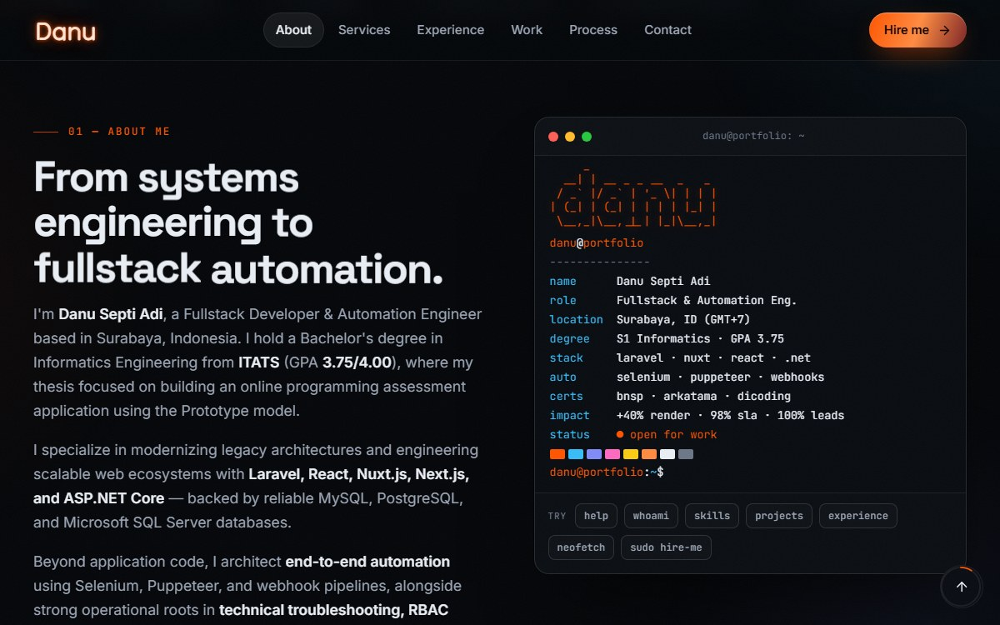
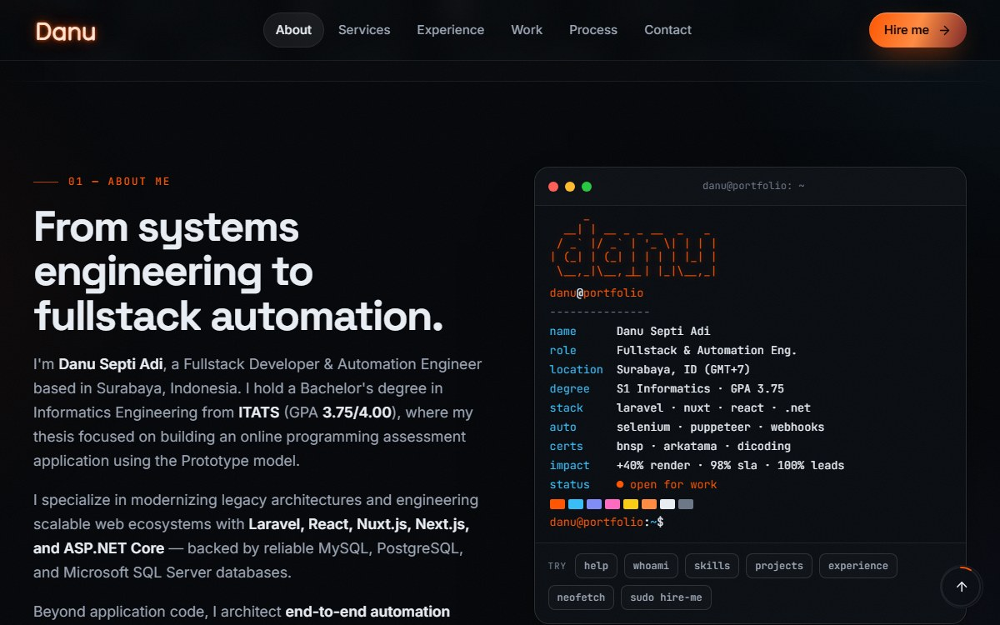
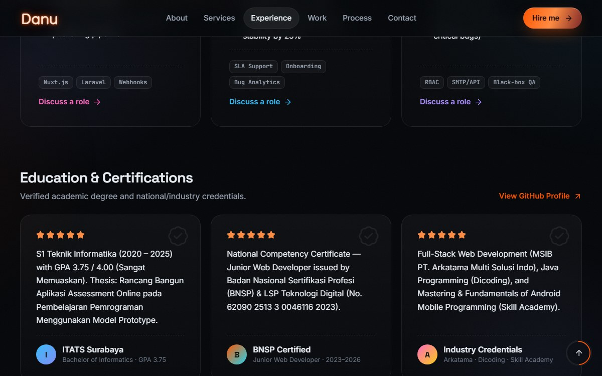
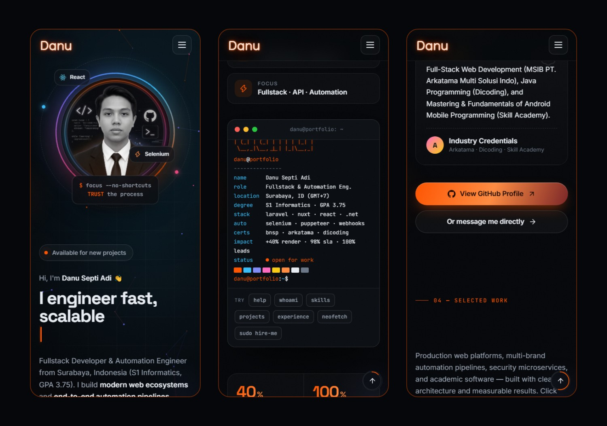

<div align="center">

# ⚡ Danu Septi Adi — Portfolio

### Fullstack Developer & Automation Engineer · Surabaya, Indonesia (GMT+7)

A fast, interactive, single-file developer portfolio crafted in **one self-contained HTML file**.<br>
Zero frameworks · zero build steps · zero runtime dependencies · ready to deploy anywhere.

[**🌐 Portfolio Profile**](https://danu-septi-adi.github.io/profile) &nbsp;·&nbsp;
[**💻 GitHub**](https://github.com/danu-septi-adi) &nbsp;·&nbsp;
[**📄 Resume (PDF)**](docs/biodata/CV_Danu_Septi_Adi_Fullstack_Automation.pdf) &nbsp;·&nbsp;
[**🎨 Customize**](docs/CUSTOMIZE.md) &nbsp;·&nbsp;
[**➕ Add a Project**](docs/ADD-A-PROJECT.md)


[](LICENSE)


</div>

---

## 👋 Overview

This portfolio highlights my engineering work as a **Fullstack Developer & Automation Engineer** (B.Sc. in Informatics Engineering, ITATS Surabaya — GPA 3.75/4.00, BNSP Certified Junior Web Developer).

Everything lives inside [`index.html`](index.html) with no bundler or external runtime libraries required:

- **Single-file architecture:** Markup, styles, scripts, inline SVG icons, animations, and core subset WOFF2 fonts are bundled together.
- **Unified 3-tier orange palette:** `#ff5500` (Primary), `#ff8c42` (Secondary), and `#ffe4d4` (Highlight).
- **Portable by design:** Runs directly from disk and deploys effortlessly to GitHub Pages, Netlify, Cloudflare Pages, or Vercel.

---

## ✨ Key Features

<table>
<tr><td width="50%" valign="top">

**🎬 Motion & Visual Craft**
- Fastboot-inspired **boot screen** (`deploy --stack fullstack-automation`, skippable anytime)
- Interactive **Canvas 2D particle network** that responds to cursor movement
- Typewriter hero headline, word-by-word heading reveals, and scroll-triggered transitions
- Portrait framed in a multi-ring neon halo with orbiting accents and floating tech chips
- 3-D perspective tilt, cursor-tracking card spotlights, and magnetic CTA buttons
- Flickering neon **Danu** wordmark and footer sign

</td><td width="50%" valign="top">

**🧩 Interactive Experience**
- Built-in **interactive terminal** (`help`, `whoami`, `skills`, `projects`, `open <name>`, `neofetch`, `cd <section>`, `github`, `portfolio`, `sudo hire-me`) with tab completion and command history
- **Featured case study** (*Multi-Brand Web & Lead Automation*) with an animated CSS phone mockup
- **Filterable project grid** (`Fullstack`, `Automation`, `Security`, `Systems`) with keyboard-accessible case-study modals
- **Experience & Automation Matrix** showcasing live KPIs, pipeline status, and verified credentials (*ITATS*, *BNSP*, *Arkatama*, *Dicoding*, *Skill Academy*)
- Easter eggs: Konami code & hidden terminal commands

</td></tr>
<tr><td valign="top">

**📬 Working Contact Form**
- Delivers inquiries straight to `danuseptiadi2291@gmail.com` via [FormSubmit](https://formsubmit.co) without a backend
- Client-side validation, honeypot spam protection, and confetti feedback on submission
- Automatic `mailto:` fallback if network delivery fails
- One-click email copy and a live `Surabaya, ID (GMT+7)` clock

</td><td valign="top">

**✅ Performance & Accessibility**
- Fully responsive from `320px` mobile viewports to `4K` displays
- Honors `prefers-reduced-motion` for reduced-motion preferences
- Skip link, visible focus rings, ARIA attributes, and full keyboard support for modals and mobile navigation
- SEO & social-ready: Open Graph metadata, JSON-LD `Person` schema, and inline SVG favicon

</td></tr>
</table>

---

## 📸 Visual Tour

<table>
<tr>
<td width="50%"><br><sub><b>Featured Case Study</b> — Multi-Brand Web & Lead Automation with a pure CSS phone mockup</sub></td>
<td width="50%"><br><sub><b>Project Grid</b> — animated SVG icons, 3-D tilt, and live category filters</sub></td>
</tr>
<tr>
<td><br><sub><b>Case-Study Modal</b> — architecture overview, highlights, and tech stack</sub></td>
<td><br><sub><b>Interactive Terminal</b> — run <code>neofetch</code>, <code>whoami</code>, or <code>sudo hire-me</code></sub></td>
</tr>
<tr>
<td><br><sub><b>Experience & Automation Matrix</b> — live KPIs and system pipeline table</sub></td>
<td><br><sub><b>Credentials & Certifications</b> — academic and industry verification</sub></td>
</tr>
</table>



---

## 🚀 Quick Start

### Option A: GitHub Pages
1. Push this repository to GitHub (e.g. `danu-septi-adi` or `danu-septi-adi.github.io`).
2. Open **Settings → Pages**.
3. Under *Build and deployment*, select **Deploy from a branch**, choose **`main`** and **`/ (root)`**, then click **Save**.

### Option B: Any Static Host
Deploy [`index.html`](index.html) (along with `docs/biodata/` if linking the local photo and resume) to [Netlify Drop](https://app.netlify.com/drop), Cloudflare Pages, Vercel, or any static web server.

### Option C: Run Locally
Open [`index.html`](index.html) directly in a browser, or start a local static server:
```bash
python -m http.server 8080
```

---

## 🧩 Repository Structure

```text
.
├── index.html                  # Complete self-contained portfolio (HTML + CSS + JS + embedded assets)
├── LICENSE                     # MIT License
├── README.md                   # Project documentation
└── docs/
    ├── ADD-A-PROJECT.md        # Guide for adding new project cards & animated icons
    ├── CUSTOMIZE.md            # Section-by-section customization guide
    ├── biodata/                # Resume (PDF/DOCX) and portrait photos
    ├── icon-templates/         # SVG icon templates
    └── screenshots/            # Up-to-date desktop & mobile screenshots
```

**Tech Stack:** Semantic HTML, modern CSS (custom properties, Grid, `color-mix()`, `:has()`), vanilla JavaScript, Canvas 2D, inline SVG, and SMIL animations. **Zero external JS/CSS libraries.**

---

## 🙏 Credits

- **Fonts:** [Inter](https://rsms.me/inter/), [Space Grotesk](https://fonts.google.com/specimen/Space+Grotesk), [JetBrains Mono](https://www.jetbrains.com/lp/mono/), and [Tilt Neon](https://fonts.google.com/specimen/Tilt+Neon) (embedded subset WOFF2); [Hind Siliguri](https://fonts.google.com/specimen/Hind+Siliguri) loaded via Google Fonts — all under [SIL OFL 1.1](https://openfontlicense.org).
- **Icons:** [Lucide](https://lucide.dev) (ISC) and [Simple Icons](https://simpleicons.org) (CC0).
- **Contact Form:** [FormSubmit](https://formsubmit.co).

---

## 📄 License

Distributed under the [MIT License](LICENSE). See [`LICENSE`](LICENSE) for full terms.

---

<div align="center">

Built with ♥ by **[Danu Septi Adi](https://github.com/danu-septi-adi)** — Fullstack Developer & Automation Engineer from Surabaya, Indonesia.<br>
Let's collaborate → **danuseptiadi2291@gmail.com** · [GitHub](https://github.com/danu-septi-adi) · [Portfolio](https://danu-septi-adi.github.io/profile)

</div>
